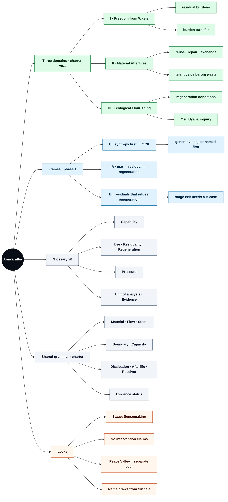
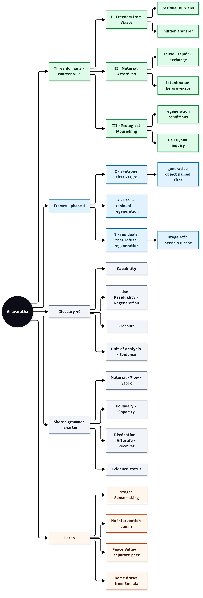

# Concept map

**Sources:** Charter §3 shared grammar + §5 domains: `anavaratha-legacy/raw/IntuituiLabs_Anavaratha/ANAVARATHA_CHARTER_V0_1.md`. Frames: `phase1/FRAME_INVERSION.md`, `phase1/FRAME_C_SYNTROPY.md`. Glossary: `phase1/GLOSSARY_v0.md`. Locks: Naveen's decisions (Nov 2026) + `phase1/BOUNDARY_MEMO.md`, `phase1/KILL_LOG.md`.

**Notes:** Drawn as a left-to-right tree. The earlier `mindmap` layout overlapped labels (Locks over Glossary, Shared grammar over the root).
