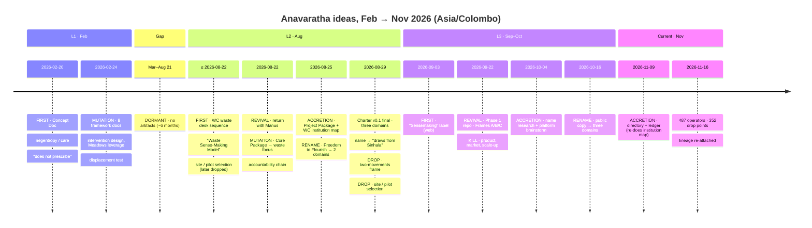

# Chronology Feb → Nov 2026

**Sources:** `anavaratha-legacy/CHRONOLOGY.md` §A (events) and §B (concept lineage). Event type words (FIRST / MUTATION / DORMANT / REVIVAL / ACCRETION / RENAME / DROP / KILL) follow §A "Concept effect".

**Notes:** Dates are Asia/Colombo; confidence H/M/L per CHRONOLOGY. Oct 4 exports are dated by export, not authorship.
