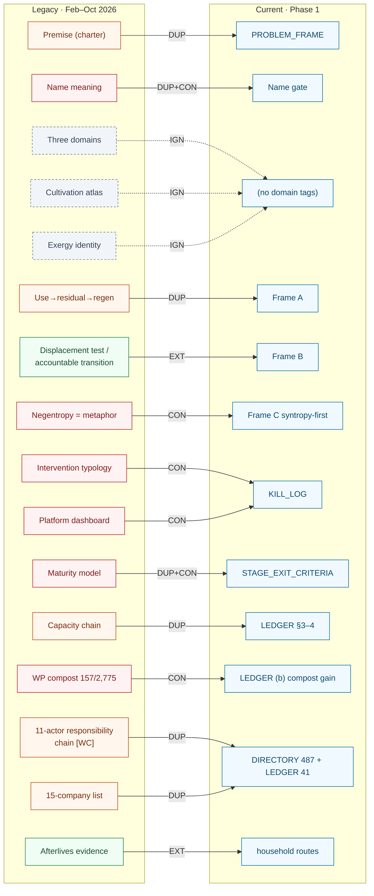
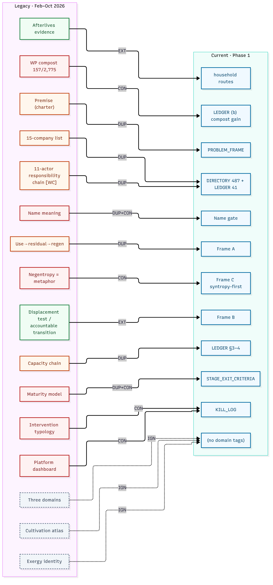

# Lineage: legacy → current

**Sources:** `anavaratha-legacy/OVERLAP_MAP.md` §2 codes. DUP = current redoes it unknowingly · EXT = current goes beyond · CON = conflict with a current lock · IGN = current ignores it.

**Notes:** 16 of the 27 rows in OVERLAP_MAP §2 are drawn; the rest are in `data/graph.json` (kind `legacy_concept`).
