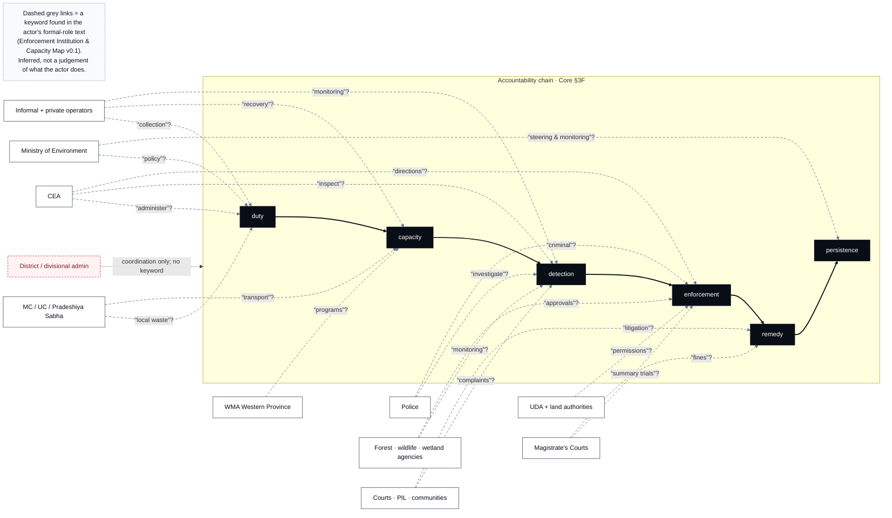
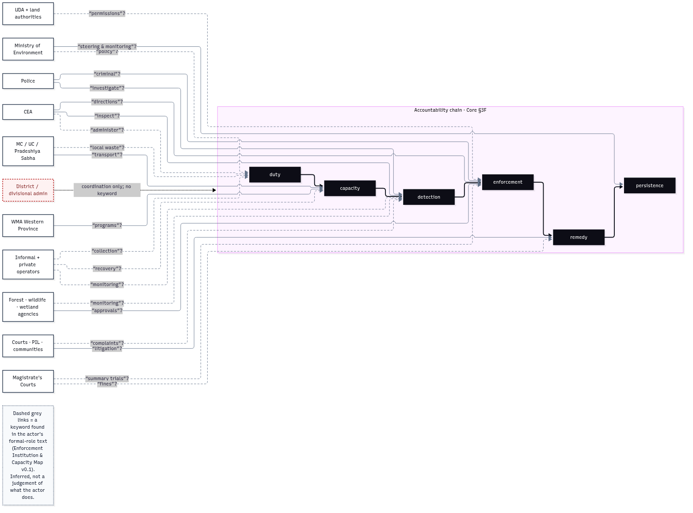

# Institution responsibility chain

**Sources:** Chain: Core Package §3F "duty → capacity → detection → enforcement → remedy → persistence" (`…/ANAVARATHA_LEARNING_LEVERAGE_ACTION_ARCHITECTURE_V0_1.md`). Actors: 11 classes in `raw/waste_cycles_anavaratha/zip_entries/Anavaratha Enforcement Institution and Capacity Map v0.1.md`.

**Notes:** Edge labels are the **keyword found in each actor's "formal role" text**, not a judgement of what they actually do. District administration has no matching keyword (red dashed box). The 11-step compliance-production chain is in `data/flows.json`.
