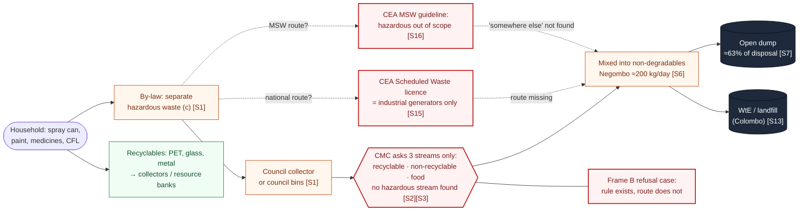
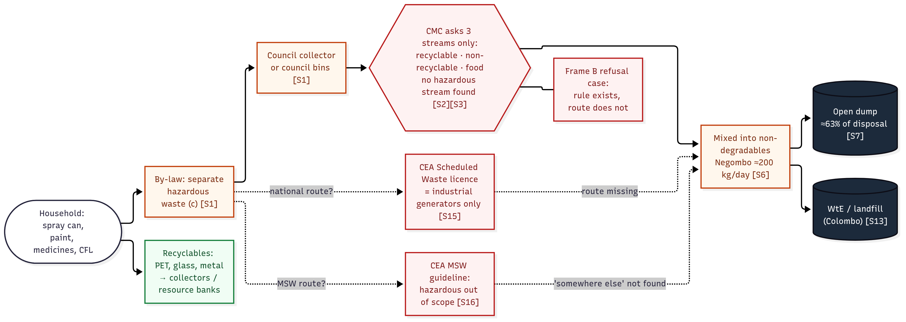

# Household hazardous waste: where the route breaks

**Sources:** `neevsk-research/anavaratha/phase1/DESK_HOUSEHOLD_WASTE_STREAMS_LK.md` §1–§4, §6. [S#] tags are that note's source keys.

**Notes:** Frame B refusal *candidate*, not a verified-on-ground finding. "≈63%" is UNDP Sri Lanka 2 Oct 2026 (primary story).
