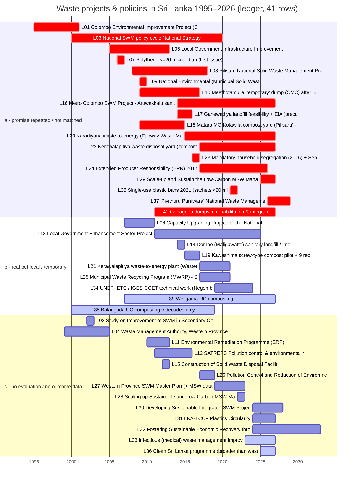

# 31-year project ledger (1995–2026)

**Sources:** `neevsk-research/anavaratha/phase1/ledger_waste_projects_lk.csv` (41 rows), pattern codes per `LEDGER_WASTE_PROJECTS_LK.md`: a = promise repeated / not matched by outcomes, b = real but local/temporary gain, c = no evaluation / no outcome data.

**Notes:** Bars use first and last year in the `years` text. Mixed codes are grouped by first letter (a+b → a, b+c → b). Ongoing items extend to 2027. L38 is drawn 2000–2019 because the ledger gives decades only ("2000s-2010s"); treat that bar as approximate. **Undated (not drawn): L41** PBF/IRF-313 (UN Peacebuilding Fund); its IATI dates 2006–2030 are placeholders and the ledger says "not found". Red = pattern a.
