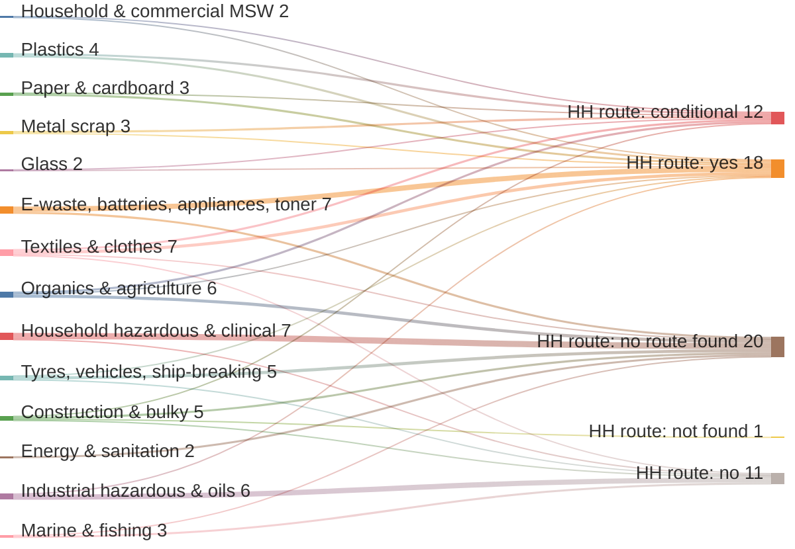
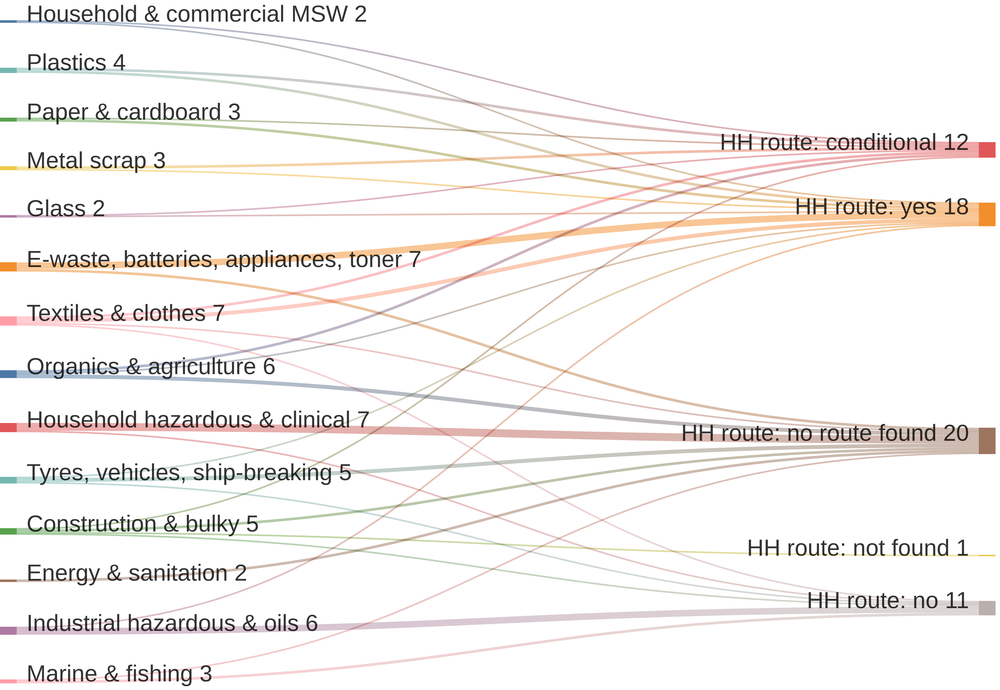

# Waste types → household route status (sankey)

**Sources:** `neevsk-research/anavaratha/phase1/WASTE_TAXONOMY_LK.md` type tables, "HH route" column (62 types).

**Notes:** Unit = number of waste **types**, not tonnage. Uses `sankey-beta`. Checked 2026-11-16: GitHub renders it natively, so no swap was needed. The PNG stays for viewers without Mermaid.
